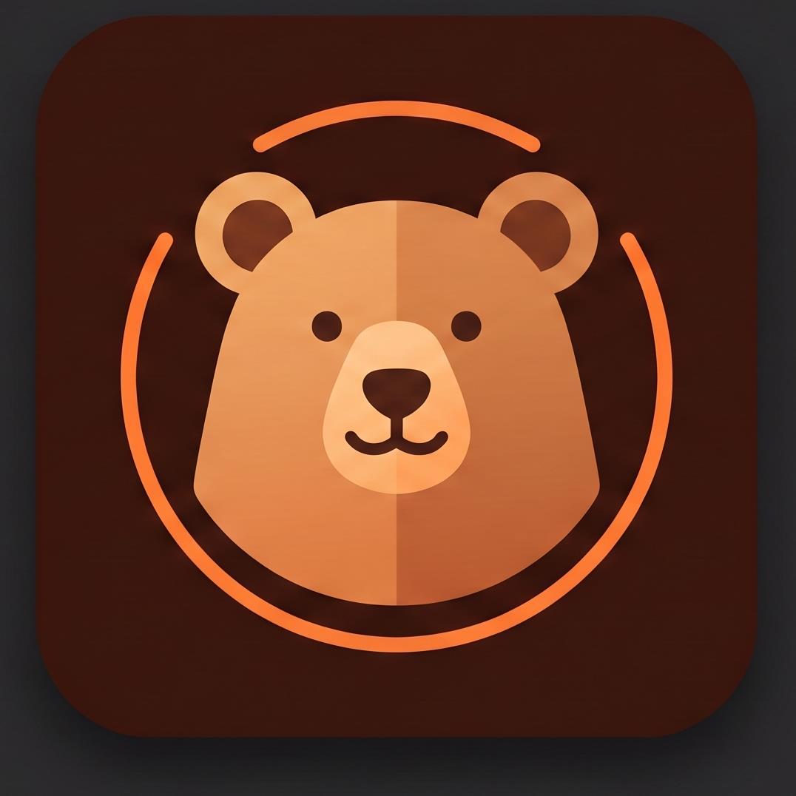

<div align="left">
  
  <h1>Bear Browser</h1>
</div>

<p>
  <a href="https://github.com/erencagsak/Bear-Browser/releases"></a>
  
  
  
  
  <a href="LICENSE"></a>
</p>

Bear Browser is a modern, sleek, and high-performance Chromium & WinUI 3 web browser designed to elevate your productivity with Arc-style vertical tabs, built-in ad blocking, and smart memory optimization.

[Download Latest Release](https://github.com/erencagsak/Bear-Browser/releases) • [Features](#features) • [Release Notes](#release-notes) • [Building from Source](#building-from-source) • [Contributing](#contributing)

---

## Features

- **Arc & Zen-Style Vertical Tabs:** Collapsible sidebar with quick tabs, tab sleep status indicators, and clean navigation.
- **Built-in AdBlock & Shields:** Ultra-fast ad and tracking protection for YouTube, websites, and popups.
- **Eco Mode & Memory Optimizer:** Automatically manages background tabs and cleans inactive memory to keep your PC fast.
- **InPrivate Browsing:** Dedicated private browsing mode with isolated session data and custom UI.
- **Password & Favorites Manager:** Seamless credential storage with Windows DPAPI encryption and intuitive bookmark management.
- **Built-in Auto Updater:** Integrated GitHub Releases update mechanism that notifies you and updates the browser seamlessly.

---

## Release Notes

### v1.0.0 (Initial Release)
- Modern WinUI 3 and Mica glass visual interface.
- Complete vertical tab management with pin, close, and sleep features.
- Fullscreen mode (F11) with autohide floating navigation controls.
- Integrated download manager and customizable settings panel.
- Live performance, RAM, and crash telemetry monitor.

---

## Building from Source

### Prerequisites
- [Visual Studio 2022](https://visualstudio.microsoft.com/) (Version 17.8 or higher)
- **Workloads:**
  - .NET Desktop Development
  - Windows App SDK / WinUI 3 template
- [.NET 9.0 SDK](https://dotnet.microsoft.com/download/dotnet/9.0)

### Clone & Build
```bash
git clone https://github.com/erencagsak/Bear-Browser.git
cd Bear-Browser
dotnet build Bear-Browser.csproj -p:Platform=x64
```

---

## Contributing

Contributions, bug reports, and suggestions are welcome!
- If you find a bug, please open an issue in the [GitHub Issues](https://github.com/erencagsak/Bear-Browser/issues) section.
- For new ideas and feature proposals, feel free to start a discussion.

---

## License

This project is proprietary and protected by copyright law. All rights reserved. See the [LICENSE](LICENSE) file for details.
